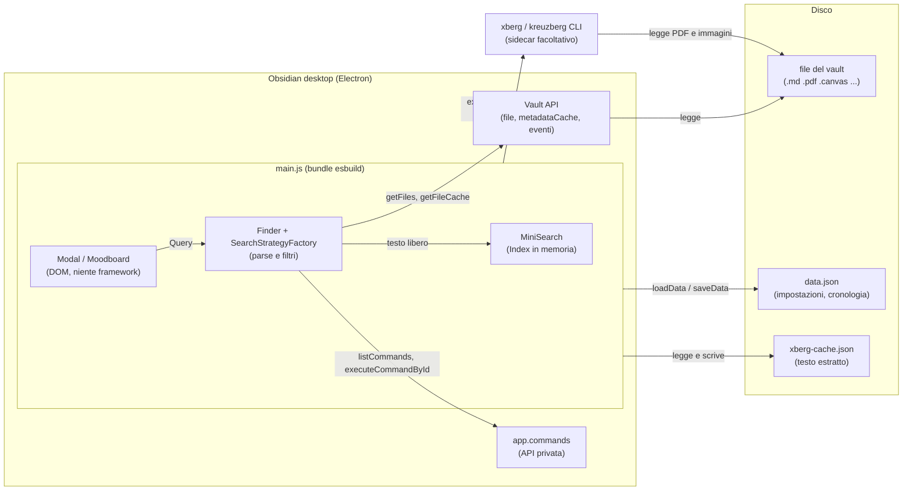
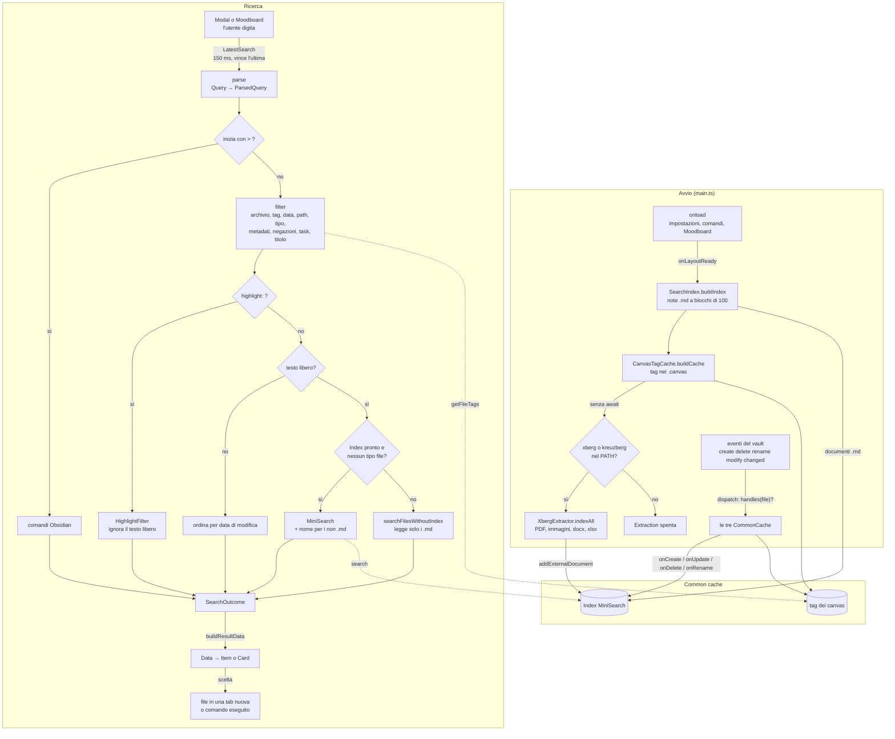

# Panoramica Architettura

## Descrizione generale

Better Finder è un plugin Obsidian scritto in TypeScript: esbuild lo impacchetta in un solo `main.js`, che Obsidian carica nella sua finestra Electron. Tutto gira nel processo dell'app e legge il vault con le API di Obsidian, quindi non c'è un server da avviare. L'unico programma esterno è Xberg, un sidecar facoltativo che il plugin lancia per estrarre testo da PDF, immagini e documenti Office. `main.ts` righe 71-84

Il prodotto è una casella sola. L'utente scrive una **Query** che mescola filtri (`#spring`, `created:this-week`, `pdf`, `-image`, `author:rossi`) e testo libero, e riceve file del vault o comandi Obsidian. Il vocabolario del dominio sta in [`CONTEXT.md`](../CONTEXT.md), e questa wiki usa i suoi termini: Modal, Moodboard, Data, Card, Item, Body, Preview, Index, Common cache. `CONTEXT.md` righe 10-50

Il codice ha tre strati e le dipendenze vanno in un verso solo, così un filtro nuovo non tocca le viste:

- **ciclo di vita** (`main.ts`): registra comandi, Moodboard e impostazioni, costruisce le tre Common cache e smista loro gli eventi del vault;
- **motore** (`src/Finder.ts`, `src/engine/`): parse della Query, filtri, ricerca nell'Index, costruzione della Data di ogni risultato;
- **viste** (`src/FinderModal.ts`, `src/FinderMoodboard.ts`, `src/component/`): il [Modal](./06-interfaccia.md#il-modal) e la [Moodboard](./06-interfaccia.md#la-moodboard), che usano lo stesso motore e disegnano la stessa Data.

I dati stanno quasi tutti in memoria e si ricostruiscono a ogni avvio, per questo la wiki non ha un capitolo sui dati. Su disco ci sono solo `data.json`, con impostazioni e cronologia, e [`xberg-cache.json`](./03-flusso-indicizzazione.md#4-xberg-estrae-il-testo-di-pdf-immagini-e-office) con il testo estratto. Le strutture si raccontano nel [flusso di indicizzazione](./03-flusso-indicizzazione.md).

Non ci sono scelte di sicurezza trasversali, perché il plugin legge e scrive il vault con i permessi dell'utente. Restano due punti delicati:

- le API private `app.commands` e `app.hotkeyManager` si raggiungono con `as any`, quindi possono cambiare a ogni versione di Obsidian senza che il compilatore se ne accorga;
- `XbergExtractor` lancia con `execFile` il primo eseguibile `xberg` o `kreuzberg` che trova nel `PATH`.

`src/engine/XbergExtractor.ts` righe 55-75

## Struttura del repository

Il repo è lo scaffolding di `obsidian-sample-plugin` cresciuto sul posto, e vive dentro `.obsidian/plugins/` del vault dell'autore. Così `npm run dev` ricompila nella cartella che Obsidian carica, e il plugin Hot Reload lo ricarica.

```
obsidian-better-finder/
├── main.ts                    → entry point (l'unico che esbuild legge)
├── src/
│   ├── Finder.ts              → motore lato viste: getResults, apertura, export
│   ├── FinderModal.ts         → il Modal (SuggestModal)
│   ├── FinderMoodboard.ts     → la Moodboard (ItemView in una tab)
│   ├── SearchUIHelper.ts      → hint bar, sub-hint delle date, anteprima dei tag
│   ├── FinderSetting.ts       → tab delle impostazioni
│   ├── const.ts               → stringhe di interfaccia in italiano
│   ├── engine/                → factory dei filtri, LatestSearch, Common cache, Data
│   │   └── search-filters/    → un file per filtro + types.ts (ParsedQuery, SearchFilter)
│   ├── component/             → componenti DOM: Modal/, Card/, ui/
│   ├── main.ts                → codice morto: plugin di esempio del template
│   └── settings.ts            → codice morto: settings del template
├── test/                      → test Jest in Node, con obsidian e minisearch finti
├── docs/                      → questa wiki e le istruzioni per agenti (docs/agents/)
├── .claude/plans/             → roadmap e piani, con decisioni e alternative scartate
├── .github/workflows/lint.yml → CI: build e lint
├── esbuild.config.mjs         → bundle main.ts → main.js, CSS → styles.css
├── manifest.json              → metadati letti da Obsidian
├── styles.css                 → artefatto di build, tracciato in git
├── CONTEXT.md                 → glossario del dominio
├── README.md, spec.md, PLAN_date_filter.md, TODO → note di progetto, in parte superate
└── package.json               → script npm, una dipendenza runtime (minisearch)
```

**⚠️ Trappola**: i `main.ts` sono due. Quello vero è in radice ed è l'unico `entryPoints` di esbuild. `src/main.ts` e `src/settings.ts` vengono dal template e non li importa nessuno, ma `tsc` li controlla lo stesso perché `tsconfig.json` include `**/*.ts`: modificarli non cambia il plugin. `esbuild.config.mjs` righe 29-35

## Glossario tecnologico

Lo stack è un plugin Obsidian, una libreria di ricerca e un binario facoltativo. Il diagramma mostra dove gira ogni pezzo:



### Stack a colpo d'occhio

| Tecnologia | Cos'è in 1 riga | Ruolo in questo progetto | Approfondimento |
|---|---|---|---|
| Obsidian API 1.12.3 | Le classi che un plugin estende (`Plugin`, `SuggestModal`, `ItemView`) e i servizi dell'app | Viste, lettura dei file, eventi, tag e frontmatter già parsati | [Interfaccia](./06-interfaccia.md) |
| TypeScript 4.7.4 | JavaScript con tipi statici | Linguaggio unico; `tsc` fa solo il controllo dei tipi | - |
| esbuild 0.17.3 | Bundler JavaScript | Produce `main.js` in CommonJS e rinomina il CSS in [`styles.css`](./05-ci-cd.md#la-build) | [La build](./05-ci-cd.md#la-build) |
| MiniSearch 7.2.0 | Ricerca full-text in memoria, in JavaScript | Unica dipendenza runtime: è l'[Index](./03-flusso-indicizzazione.md#2-lindex-minisearch-si-costruisce-a-blocchi-di-100-note) | [Indicizzazione](./03-flusso-indicizzazione.md) |
| Xberg CLI | Programma che estrae testo da PDF e Office e fa OCR sulle immagini | Sidecar facoltativo: se manca, l'Extraction si spegne | [Xberg](./03-flusso-indicizzazione.md#4-xberg-estrae-il-testo-di-pdf-immagini-e-office) |
| Jest 29 + ts-jest | Test runner per TypeScript | Test della logica in Node, senza Obsidian | [Testarlo con Jest](./07-aggiungere-un-filtro.md#testarlo-con-jest) |
| ESLint 8.57 + Prettier 3 | Linter e formattatore | Regole in `.eslintrc`; il lint gira in CI | [CI/CD](./05-ci-cd.md) |
| GitHub Actions | La CI di GitHub | Build e lint su Node 20 e 22 a ogni push | [I job](./05-ci-cd.md#i-job) |

## Il giro completo

Il plugin ha due giri che si incontrano nelle Common cache. L'avvio le costruisce e gli eventi del vault le tengono allineate; la ricerca le legge a ogni Query.



**Come leggerlo**:

1. **Avvio.** `onload` registra comandi, Moodboard e impostazioni; il lavoro pesante aspetta `onLayoutReady` per non rallentare l'apertura di Obsidian. Prima si costruisce l'Index delle note, poi la [cache dei tag dei canvas](./03-flusso-indicizzazione.md#3-i-tag-dei-canvas-vanno-in-cache), infine l'Extraction parte senza `await` e può finire minuti dopo. Racconto completo in [Indicizzazione all'avvio](./03-flusso-indicizzazione.md).
2. **Common cache.** Le tre cache implementano [`CommonCache`](./03-flusso-indicizzazione.md#5-gli-eventi-del-vault-arrivano-alle-tre-common-cache), e `main.ts` passa ogni evento a quelle per cui `handles(file)` è vero. Si aggiornano tutte allo stesso modo ma rispondono in modo diverso a una lettura stantia: è una scelta scritta in `CONTEXT.md`, da non uniformare. `main.ts` righe 91-118
3. **Dalla Query alla [ParsedQuery](./02-flusso-ricerca.md#2-la-query-diventa-una-parsedquery).** [`LatestSearch`](./02-flusso-ricerca.md#1-digiti-e-parte-solo-lultima-ricerca) aspetta 150 ms e lascia arrivare solo l'ultima ricerca. Ogni filtro estrae il suo token e lo toglie dal testo, e quello che resta è testo libero. Il prefisso `>` porta nel [Command mode](./04-sintassi-query.md#comandi-obsidian).
4. **Filtri, poi testo libero.** I filtri restringono i file con dati che Obsidian ha già in cache: tag, frontmatter, date, estensione. Solo dopo il testo libero passa dall'Index o dalla lettura diretta, e il risultato è un [`SearchOutcome`](./02-flusso-ricerca.md#4-il-testo-libero-passa-dallindex). Dettaglio in [Ricerca dal Modal](./02-flusso-ricerca.md). `src/Finder.ts` righe 89-105
5. **Data e scelta.** `buildResultData` decide una volta per risultato cosa mostrare, e Modal e Moodboard disegnano la stessa [Data](./06-interfaccia.md#la-data-di-un-risultato). La scelta apre sempre il file in una tab nuova.

**⚠️ Trappola**: un tipo file esplicito nella Query spegne l'Index. Con `pdf contratto` la lettura diretta guarda solo il contenuto dei `.md`, quindi il testo estratto dai PDF non si trova. `src/engine/SearchStrategy.ts` righe 167-185

Lo schema in `spec.md` è superato. Le differenze con il codice:

| Nello schema (`spec.md` righe 27-46) | Nel codice |
|---|---|
| `Finder.search(query)` con debounce | Il debounce sta in `LatestSearch`, uno per vista; `Finder.getResults` restituisce un `SearchOutcome` |
| Filtri in ordine tag, data, path, tipo, task, titolo | Prima l'esclusione di `#archive`, poi anche metadati e negazioni (`src/engine/SearchStrategy.ts` righe 68-107) |
| Index usato "se pronto e solo markdown" | Index usato se la Query **non** ha tipi file; contiene anche PDF e immagini estratti |
| `FinderCard` con Card lazy-loaded | `FinderMoodboard`, griglia di Card o List di Item, a blocchi di 20 |

## Componenti principali

- **`ObsidianBetterFinder`** (`main.ts`): ciclo di vita; registra i [comandi del plugin](./04-sintassi-query.md#comandi-del-plugin), la Moodboard, il ribbon e le [impostazioni](./04-sintassi-query.md#impostazioni), poi smista gli eventi alle Common cache.
- **`Finder`** (`src/Finder.ts`): `getResults`, lista dei file invalidata dagli eventi, comandi, export e apertura. Ogni vista aperta ne crea una e la libera alla chiusura con `dispose()`.
- **[`LatestSearch`](./02-flusso-ricerca.md#1-digiti-e-parte-solo-lultima-ricerca)** (`src/engine/LatestSearch.ts`): debounce e ultima ricerca che vince, una istanza per vista.
- **[`SearchStrategyFactory`](./07-aggiungere-un-filtro.md#registrarlo-nella-factory)** (`src/engine/SearchStrategy.ts`): singleton che registra i filtri e possiede `parse`, `filter` e `filterFreeText`.
- **Filtri** (`src/engine/search-filters/`): una sottoclasse di [`SearchFilter`](./07-aggiungere-un-filtro.md#anatomia-di-un-filtro) per filtro. La sintassi che riconoscono è in [Sintassi della query](./04-sintassi-query.md).
- **Common cache** (`src/engine/`): [`SearchIndex`](./03-flusso-indicizzazione.md#2-lindex-minisearch-si-costruisce-a-blocchi-di-100-note) con la ricerca senza Index, [`CanvasTagCache`](./03-flusso-indicizzazione.md#3-i-tag-dei-canvas-vanno-in-cache) e `XbergExtractor`.
- **`buildResultData`** e **`getFileTags`**, in `src/engine/ResultData.ts` e `src/engine/fileTags.ts`: la Data di un risultato e i tag di un file, condivisi da viste e `TagsFilter`.
- **[`SearchHistory`](./06-interfaccia.md#cronologia-delle-ricerche)** (`src/engine/SearchHistory.ts`): le ultime 20 Query che hanno portato ad aprire qualcosa.
- **Viste e componenti** (`src/FinderModal.ts`, `src/FinderMoodboard.ts`, `src/component/`): `ModalUI` e `ModalItem` per gli Item, `CardUI`, `GridCard` e `ListCard` per la Moodboard, e in `ui/` il [Body](./06-interfaccia.md#body-occurrences-e-preview) con Occurrences e Preview, e i chip.

## Pattern architetturali rilevati

- **Filtro con parse incorporato.** Ogni filtro ha `extract`, che legge il proprio token, `removeFrom`, che lo toglie, e `filter`, che restringe i file. `parse` li chiama a cascata e ognuno vede il testo già ripulito dai precedenti. L'ordine di estrazione è diverso da quello di applicazione, ed è il punto che si sbaglia più spesso: vedi [Aggiungere un filtro](./07-aggiungere-un-filtro.md). `src/engine/SearchStrategy.ts` righe 221-243
- **Una sola interfaccia per le cache.** `CommonCache` copre solo il lato scrittura: `handles(file, oldPath)` decide chi possiede un file e `deferred` dice se aspettare. Una cache nuova è una voce in più nella lista di `main.ts`, senza toccare gli handler. `src/engine/CommonCache.ts` righe 11-40
- **L'ultima ricerca vince.** Una ricerca superata non si risolve mai, perché `SuggestModal` mostrerebbe qualunque promessa risolta, anche vecchia. `src/engine/LatestSearch.ts` righe 9-13
- **Singleton con `getInstance()`.** `SearchStrategyFactory`, le tre Common cache e `SearchHistory` sono condivisi da viste e filtri senza passarli per costruttore. Il prezzo: `onunload` è vuoto, quindi disabilitare il plugin non li libera, e i test azzerano `_instance` a mano. `main.ts` righe 195-197
- **Lavoro a blocchi con cessione all'event loop.** `buildIndex` indicizza 100 note per volta con un `setTimeout(0)` fra i blocchi, e la lettura diretta legge 50 file in parallelo. Entrambi esistono perché la UI di Obsidian gira sullo stesso thread. `src/engine/SearchIndex.ts` righe 69-92
- **Sidecar che si spegne da solo.** `XbergExtractor` prova `xberg` e poi `kreuzberg` con `--version`; se nessuno risponde si disattiva e lo scrive solo in console. `src/engine/XbergExtractor.ts` righe 55-75
- **Viste che disegnano e basta.** La Data si decide in `buildResultData`, le Occurrences in `bodyText`, e `ImagePreview.hasPreview` è l'unico posto che dice se un file ha una Preview. `src/engine/ResultData.ts` righe 34-53; `src/engine/occurrences.ts` righe 46-66

### Documenti del progetto e codice

**⚠️ Trappola**: le note di progetto dicono cose che il codice non fa più. La wiki segue il codice:

| Documento | Nel codice |
|---|---|
| [`README.md`](../README.md) righe 85-86: `today #react`, `this week task-todo:` | Servono `created:` o `modified:` davanti ([date](./04-sintassi-query.md#date)) |
| [`README.md`](../README.md) righe 48-49 e 91-97: comandi "Open Smart Search" e "Open Command View" che elenca comandi | I comandi si chiamano "Open Better Finder Modal" e "Open Better Finder View", e la view è la Moodboard dei file (`main.ts` righe 47-61) |
| [`spec.md`](../spec.md) righe 84-102: `Card.ts`, `HistoryBar.ts`, `ResultsContainer.ts` | Non esistono; la cronologia si naviga con le frecce nella Moodboard |
| [`CONTEXT.md`](../CONTEXT.md) righe 82-99: Occurrences su Card e Item, pulsante per la Preview | Gli Item hanno le Occurrences; le Card della griglia non hanno ancora né Body né pulsante ([Body e Preview](./06-interfaccia.md#body-occurrences-e-preview)) |
| `CLAUDE.md` riga 19: la Data si chiama ancora `Card`, in una cartella `component/interface/` | Si chiama già `ResultData`, in `src/engine/ResultData.ts`; la cartella `interface/` non c'è più |

## Avviarlo in locale

Il plugin si prova dentro un vault vero, perché Obsidian non ha un modo per lanciarlo da solo. Il riassunto di [`README.md`](../README.md) righe 14-75:

1. Clona il repo in `<vault>/.obsidian/plugins/obsidian-better-finder`.
2. Installa le dipendenze con `npm install`.
3. Lancia `npm run dev`: esbuild ricompila `main.js` in watch a ogni modifica.
4. Installa il plugin Hot Reload nel vault. Il file vuoto `.hotreload`, già nel repo, gli dice di ricaricare questo plugin.
5. Abilita "Obsidian Better Finder" fra i plugin della community e prova sia il Modal sia la Moodboard.

Per la logica pura bastano `npm test`, che il README non nomina, e `npx jest test/<file>.test.ts`. I test girano in Node e sostituiscono `obsidian` e `minisearch` con dei mock, quindi tutto quello che tocca il DOM si controlla a mano in Obsidian. `jest.config.js` righe 1-11

Xberg non si installa con `npm`: serve il binario `xberg` o `kreuzberg` nel `PATH`, e senza la ricerca nei PDF resta spenta. Secondo il `TODO` non è mai stato provato con il binario reale.

## Ambienti

Il plugin non ha ambienti di deploy: gira nel vault di chi lo installa.

| Ambiente | Branch CI | Database | Note |
|---|---|---|---|
| Sviluppo | qualsiasi branch | nessuno; `data.json` locale | `npm run dev` in watch dentro la cartella del plugin, ricaricato da Hot Reload |
| Uso | `master` | nessuno | `main.js`, `manifest.json` e `styles.css` copiati nella cartella del plugin del vault |

**⚠️ Trappola**: `manifest.json` dichiara `isDesktopOnly: false`, ma `XbergExtractor` importa `child_process` al caricamento del modulo. Su mobile il plugin probabilmente non parte; non è verificato. `src/engine/XbergExtractor.ts` riga 1

## Pipeline di deploy

La CI è un solo workflow GitHub Actions, [Node.js build](./05-ci-cd.md#i-job), che fa build e lint su Node 20 e 22 e non lancia i test. Il rilascio è manuale con [`npm run version`](./05-ci-cd.md#come-si-rilascia), che aggiorna `manifest.json` e `versions.json`, e `main.js` va allegato alla release perché non è in git. Tutto il resto è in [CI/CD](./05-ci-cd.md).

## File chiave

| File | Ruolo |
|---|---|
| `main.ts` | Entry point: registrazioni, costruzione delle Common cache, `dispatch` degli eventi del vault |
| `src/Finder.ts` | `getResults` per entrambe le viste, `SearchOutcome`, `openResult`, export |
| `src/engine/LatestSearch.ts` | Debounce e regola dell'ultima ricerca |
| `src/engine/SearchStrategy.ts` | I due ordini dei filtri (`parse` e `filter`) e la scelta fra Index e lettura diretta |
| `src/engine/search-filters/types.ts` | `ParsedQuery` e la classe base dei filtri |
| `src/engine/CommonCache.ts` | Il contratto delle tre Common cache |
| `src/engine/ResultData.ts` | Unico builder della Data per Modal e Moodboard |
| `src/FinderMoodboard.ts` | `FINDER_VIEW_TYPE = "better-finder-view"`, salvato nei layout: non va cambiato |
| `CONTEXT.md` | Glossario del dominio e la scelta sulle letture stantie |
| `.claude/plans/roadmap-better-finder.md` | Decisioni della roadmap, per esempio Xberg come sidecar al posto di NAPI o WASM |

## File di configurazione

| File | Scopo |
|---|---|
| `manifest.json` | Metadati per Obsidian: id `obsidian-better-finder`, versione 1.0.0, `minAppVersion`. In git; la `description` è ancora quella del template |
| `package.json` | Script `dev`, `build`, `test`, `lint`, `format`, `version` e dipendenze. In git; nome e descrizione sono del template |
| `esbuild.config.mjs` | Bundle di produzione e watch di sviluppo; rinomina `main.css` in `styles.css`. In git |
| `tsconfig.json` | Opzioni di `tsc` con `baseUrl` per gli import `src/...`; include `**/*.ts`, quindi anche test e file morti. In git |
| `jest.config.js` | Test in `test/`, con `obsidian`, `minisearch` e i `.css` sostituiti da mock. In git |
| `.eslintrc` | Regole usate da `npm run lint`. In git. `eslint.config.mts` importa `typescript-eslint` ed `eslint-plugin-obsidianmd`, assenti dal lockfile: sembra non usato |
| `.github/workflows/lint.yml` | Workflow della CI. In git |
| `versions.json` | Versione del plugin → versione minima di Obsidian. In git |
| `data.json` | Impostazioni e cronologia, scritto da Obsidian. Fuori da git (`.gitignore`) |
| `xberg-cache.json` | Testo estratto, scritto dal plugin in `.obsidian/plugins/obsidian-better-finder/`. Non è in `.gitignore`, quindi può finire in un commit |
