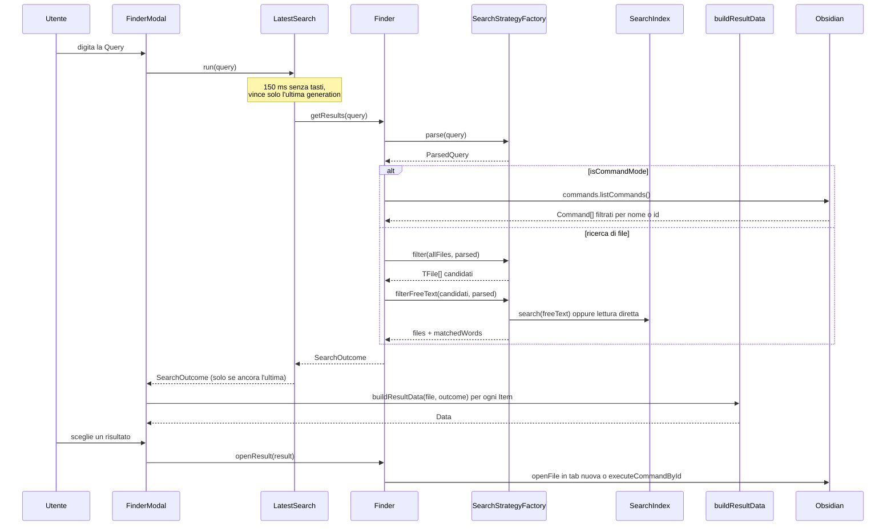

# Flusso: ricerca dal Modal

L'utente apre il [Modal](./06-interfaccia.md#il-modal) con il comando [Open Better Finder Modal](./04-sintassi-query.md#comandi-del-plugin) e scrive una Query che mescola filtri e testo libero, per esempio `#spring -image created:this-week author:rossi architettura`. Ottiene una lista di note, allegati o comandi Obsidian, se la Query inizia con [`>`](./04-sintassi-query.md#comandi-obsidian), e apre quello che sceglie. Ti serve quando un risultato manca, compare dove non dovrebbe o mostra il Body sbagliato.

La [Moodboard](./06-interfaccia.md#la-moodboard) fa lo stesso giro e cambia nel disegno, a Card in blocchi di 20, e nel restare aperta. La sintassi dei filtri è in [Sintassi della query](./04-sintassi-query.md), l'Index in [Indicizzazione](./03-flusso-indicizzazione.md).



### 1. Digiti e parte solo l'ultima ricerca

`FinderModal` è una `SuggestModal` di Obsidian: a ogni tasto Obsidian chiama `getSuggestions`, che passa la Query a `LatestSearch.run`. Ogni apertura del Modal crea il suo `Finder` e il suo `LatestSearch`. `src/FinderModal.ts` righe 21-26 e 56-62

`LatestSearch` aspetta 150 ms senza tasti e numera ogni ricerca con una `generation`; la Promise si risolve solo se nel frattempo non è partita una ricerca più nuova:

```typescript
run(query: string): Promise<T> {
  if (this.timer !== null) {
    window.clearTimeout(this.timer);
  }

  const generation = ++this.generation;

  return new Promise((resolve) => {
    this.timer = window.setTimeout(async () => {
      this.timer = null;
      const outcome = await this.source.getResults(query);

      if (generation === this.generation) {
        resolve(outcome);
      }
    }, this.delayMs);
  });
}
```

`src/engine/LatestSearch.ts` righe 23-40

Una ricerca superata (la *Superseded search* di [`CONTEXT.md`](../CONTEXT.md)) resta appesa per sempre, senza risolversi né fallire. È voluto: `SuggestModal` disegna qualunque Promise si risolva senza guardare la Query, quindi risolverla mostrerebbe risultati vecchi e rifiutarla scriverebbe un errore. Alla chiusura del Modal `cancel()` scarta anche la ricerca in volo. `src/engine/LatestSearch.ts` righe 9-13 e 42-50

**⚠️ Trappola.** Un `await` su `run` per ogni chiamata resta bloccato: le chiamate superate non tornano mai.

`Finder.getResults` fa i passi 2-4. La lista dei file del vault sta in cache e si invalida solo su `create`, `delete` e `rename`, perché ricostruirla a ogni tasto contribuiva al freeze sui vault grandi. `src/Finder.ts` righe 89-105

### 2. La query diventa una ParsedQuery

`SearchStrategyFactory.parse` trasforma la stringa nella `ParsedQuery` che il resto del flusso legge: ogni filtro riconosce il suo token con `extract` e lo toglie con `removeFrom`, in cascata, e quello che resta è il testo libero. Come si scrive un filtro è in [Anatomia di un filtro](./07-aggiungere-un-filtro.md#anatomia-di-un-filtro). `src/engine/search-filters/types.ts` righe 4-18

L'ordine di estrazione conta: il Command mode si controlla per primo e, con `>` in testa, il parse finisce lì. Le [negazioni](./04-sintassi-query.md#negazione) vengono subito dopo, perché altrimenti `-image` lo catturerebbe il filtro dei tipi file e `-#draft` quello dei tag:

```typescript
let remainingText = trimmedInput;

// 1.5 Extract negations (-image, -#tag) PRIMA delle altre strategy:
// "-image" verrebbe altrimenti catturato da FileTypeFilter, "-#tag" da TagsFilter
const negationStrategy = this.getStrategy('not') as NegationFilter;

result.negations = negationStrategy.extract(remainingText);
remainingText = negationStrategy.removeFrom(remainingText);

// 2. Extract tags (#react #css)
const tagStrategy = this.getStrategy('tag') as TagsFilter;

result.tags = tagStrategy.extract(remainingText);
remainingText = tagStrategy.removeFrom(remainingText);

// 3. Extract date filters (modified:VALUE or created:VALUE)
const modifiedStrategy = this.getStrategy('modified') as ModifiedFilter;
const createdStrategy = this.getStrategy('created') as CreatedFilter;

result.dateFilter = modifiedStrategy.extract(remainingText) ?? createdStrategy.extract(remainingText);
remainingText = modifiedStrategy.removeFrom(remainingText);
remainingText = createdStrategy.removeFrom(remainingText);
```

`src/engine/SearchStrategy.ts` righe 221-242

Seguono tipi file, `title:`, `task:`, `path:` e `highlight:`; i [metadati del frontmatter](./04-sintassi-query.md#metadati-del-frontmatter) vanno per ultimi fra i `chiave:valore`, così le chiavi riservate sono già consumate e `task:` non diventa un metadato. `src/engine/SearchStrategy.ts` righe 285-290

**Esempio tracciato.** La Query `#spring -image created:this-week author:rossi architettura` diventa questa `ParsedQuery`, con `-image` espanso nelle cinque estensioni delle immagini:

```json
{
  "rawInput": "#spring -image created:this-week author:rossi architettura",
  "isCommandMode": false,
  "negations": { "extensions": ["png", "jpg", "jpeg", "gif", "webp"], "tags": [] },
  "tags": ["#spring"],
  "dateFilter": { "field": "created", "value": "this-week" },
  "fileTypes": [],
  "metadataFilters": [{ "key": "author", "value": "rossi" }],
  "freeText": "architettura"
}
```

**⚠️ Trappola.** [`title:`](./04-sintassi-query.md#titolo) non toglie il termine dalla Query: `removeFrom` rimuove solo il prefisso, e con `title:docker` il `freeText` vale `docker`. Quella parola filtra i nomi al passo 3 e poi passa anche dall'Index, che cerca nel contenuto. `src/engine/search-filters/TitleFilter.ts` righe 25-28

### 3. I filtri restringono i file del vault

`SearchStrategyFactory.filter` parte da tutti i file del vault, non solo dalle note, e applica i filtri presenti nella `ParsedQuery`. L'ordine di applicazione è diverso da quello di estrazione:

```typescript
results = archiveStrategy.excludeArchived(results, parsed.tags, app);

if (parsed.tags.length > 0) {
  results = this.applyStrategy('tag', results, parsed.tags, app);
}

if (parsed.dateFilter) {
  results = this.applyStrategy(parsed.dateFilter.field, results, parsed.dateFilter, app);
}

// Path filter prima del file type filter, così lavora su tutti i file
if (parsed.pathFilter) {
  results = this.applyStrategy('path', results, parsed.pathFilter, app);
}

results = this.applyFileTypes(results, parsed, app);
// ...
```

`src/engine/SearchStrategy.ts` righe 68-92

Dopo i tipi file vengono metadati, negazioni, task e infine lo scope titolo. Il primo passaggio gira sempre: le note con [`#archive`](./04-sintassi-query.md#archivio) spariscono, a meno che la Query non chieda `#archive`. L'ordine incide sulle prestazioni e sull'ordinamento, non su quali file restano: il [filtro data](./04-sintassi-query.md#date) ordina per data decrescente, lo scope titolo per punteggio sul nome. Un filtro nuovo si inserisce a mano qui e in `parse()`, vedi [Registrarlo nella factory](./07-aggiungere-un-filtro.md#registrarlo-nella-factory). `src/engine/SearchStrategy.ts` righe 91-107

**⚠️ Trappola.** Il commento "Skip del default markdown-only quando il path filter è attivo" descrive un default che non esiste. `FileTypeFilter.filter` con lista vuota restituisce già tutti i file, quindi la sostituzione con `['*']` non cambia niente: è un residuo, non costruirci sopra. `src/engine/SearchStrategy.ts` righe 133-139

### 4. Il testo libero passa dall'Index

`filterFreeText` decide come cercare il testo libero fra i candidati rimasti e restituisce, oltre ai file, `matchedWords`: per ogni path, le parole che l'hanno fatto trovare. Le strade sono quattro:

| Condizione | Cosa succede |
|---|---|
| `highlight:` nella Query | filtro asincrono che legge le note e cerca dentro `==...==`; il testo libero viene **ignorato** |
| niente testo libero | i candidati ordinati per data di modifica decrescente, senza limite |
| nessun tipo file esplicito e Index pronto | ricerca nell'[Index MiniSearch](./03-flusso-indicizzazione.md#2-lindex-minisearch-si-costruisce-a-blocchi-di-100-note), più ricerca per nome sui file non markdown che l'Index non ha trovato |
| altrimenti | `searchFilesWithoutIndex`, che legge i file uno per uno |

Il ramo con l'Index è questo:

```typescript
if (!hasExplicitFileTypes && searchIndex.isIndexReady()) {
  const candidatePaths = new Set(files.map(f => f.path));
  const indexResults = searchIndex.search(parsed.freeText).filter(r => candidatePaths.has(r.file.path));
  const foundPaths = new Set(indexResults.map(r => r.file.path));
  const remainingNonMd = files.filter(f => f.extension !== 'md' && !foundPaths.has(f.path));
  const otherResults = searchIndex.searchInTitlesWithoutIndex(parsed.freeText, remainingNonMd);
  const matchedWords = new Map<string, string[]>(indexResults.map(r => [r.file.path, r.terms]));

  otherResults.forEach(f => matchedWords.set(f.path, freeTextWords));

  return { files: [...indexResults.map(r => r.file), ...otherResults], matchedWords };
}
```

`src/engine/SearchStrategy.ts` righe 172-183

L'Index cerca su tutto il vault e i filtri del passo 3 entrano solo come intersezione sui path. MiniSearch richiede tutte le parole, pesa 5 volte il nome del file, usa il fuzzy solo per parole di almeno 6 caratteri e il prefisso solo sull'ultima, quella che stai ancora scrivendo. `src/engine/SearchIndex.ts` righe 30-43

`SearchOutcome` è quello che `getResults` restituisce: `ParsedQuery`, risultati e `matchedWords`. MiniSearch riporta le parole come stanno nel documento, quindi un errore di battitura o un prefisso danno la parola intera; la lettura diretta riporta le parole del testo libero. `src/Finder.ts` righe 9-17

**Esempio tracciato.** In un vault con `layers.md` ("Notes on software architettura and layers"), la Query `architetura` con una t sola dà:

```json
{
  "parsed": { "freeText": "architetura", "tags": [], "fileTypes": [] },
  "results": ["layers.md"],
  "matchedWords": { "layers.md": ["architettura"] }
}
```

Con `pomo` la nota `recipe.md` ha `["pomodoro"]`; con `diagram` il file `architettura-diagram.png` si trova per nome e ha `["diagram"]`. `test/search-outcome.test.ts` righe 88-112

**⚠️ Trappola.** Un tipo file esplicito spegne l'Index. Con `pdf contratto` la `ParsedQuery` ha `fileTypes: ["pdf"]` e passa dalla lettura diretta, che legge il contenuto **solo dei `.md`**. Il testo dei PDF estratto da [Xberg](./03-flusso-indicizzazione.md#4-xberg-estrae-il-testo-di-pdf-immagini-e-office) vive solo nell'Index, quindi un PDF si trova solo se "contratto" è nel nome. `src/engine/SearchIndex.ts` righe 349-359

**⚠️ Trappola.** Finché l'Index non è pronto, nei primi secondi dopo l'avvio, ogni tasto legge tutti i candidati dal disco. Senza testo libero l'ordine finale è sempre per data di modifica, anche con `created:` che aveva ordinato per data di creazione. `src/engine/SearchStrategy.ts` righe 162-164

### 5. Ogni risultato diventa una Data e un Item

Per ogni risultato Obsidian chiama `renderSuggestion`: un comando si disegna con nome, id e hotkey, un file passa da `buildResultData`, che decide la [Data](./06-interfaccia.md#la-data-di-un-risultato), e da `ModalUI`, che la disegna come Item. Si parte dall'outcome risolto e non dall'input, che può già contenere una Query più nuova. `src/FinderModal.ts` righe 77-89

`buildResultData` decide la Data una volta per Modal e Moodboard, leggendo solo metadati in cache: le regole stanno nella [sua casa](./06-interfaccia.md#la-data-di-un-risultato). Da `matchedWords` prende le parole da cercare nel Body. `src/engine/ResultData.ts` righe 34-53

**Esempio tracciato.** `alpha.md` ha i tag `#project/alpha` e `#idea` e tre task, una fatta, sulle righe 1-3. Con la Query `#project task:` la Data è:

```json
{
  "file": "alpha.md",
  "tags": ["#project/alpha", "#idea"],
  "searchedTags": ["#project/alpha"],
  "taskInfo": { "done": 1, "total": 3 },
  "renderPreview": false,
  "snippetWords": [],
  "taskLines": [
    { "line": 1, "done": false },
    { "line": 2, "done": true },
    { "line": 3, "done": false }
  ]
}
```

`test/result-data.test.ts` righe 133-139

Con `ciao task:` la stessa nota ha anche `snippetWords: ["ciao"]`, e il Body mostra Occurrences e righe dei task insieme. `test/result-data.test.ts` righe 210-217

`ModalUI` passa la Data al [Body](./06-interfaccia.md#body-occurrences-e-preview), che legge la nota solo quando l'Item diventa visibile. `src/component/Modal/ModalUI.ts` righe 16-36

**⚠️ Trappola.** Le virgolette non fanno una ricerca per frase: il tokenizer di MiniSearch le scarta, e `"ciao mondo"` trova le note con le due parole anche lontane, ciascuna evidenziata da sola (issue #10).

**⚠️ Trappola.** `FinderModal` definisce sia `renderSuggestion` sia `renderModalItem`, con lo stesso corpo. Le typings installate di Obsidian dichiarano solo `renderSuggestion`, che è quello chiamato; `renderModalItem` non lo chiama nessuno. `src/FinderModal.ts` righe 64-70

### 6. La scelta apre il file o lancia il comando

Quando l'utente sceglie un Item, il Modal salva la Query nella [cronologia](./06-interfaccia.md#cronologia-delle-ricerche) e chiama `Finder.openResult`:

```typescript
openResult(result: SearchResult): void {
  if (isCommand(result)) {
    (this.app as any).commands.executeCommandById(result.id);

    return;
  }

  // 'tab' apre sempre in una nuova tab invece di sostituire quella corrente.
  this.app.workspace.getLeaf('tab').openFile(result);
}
```

`src/Finder.ts` righe 178-187

Un comando passa da `app.commands`, un'API privata di Obsidian assente dalle typings, da cui il cast `as any`.
