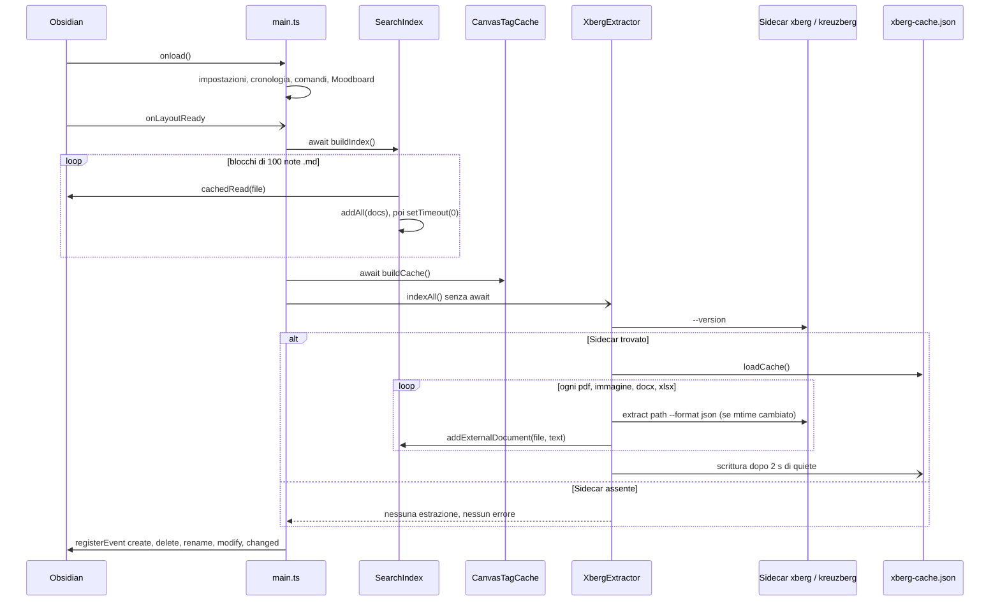

# Indicizzazione all'avvio e Common cache allineate

Quando Obsidian carica il plugin, `main.ts` costruisce le tre Common cache che la ricerca legge. Sono l'Index MiniSearch delle note, la cache dei tag dei canvas e, se c'è il Sidecar Xberg, il testo estratto da PDF, immagini e documenti Office. Da lì in poi ogni evento del vault passa a tutte e tre attraverso la stessa interfaccia, `CommonCache`. Questo capitolo ti serve quando un file esiste ma la ricerca non lo trova, quando l'avvio è lento o quando aggiungi un tipo di file da indicizzare.

I termini vengono dal glossario del progetto, [`CONTEXT.md`](../CONTEXT.md): Index, Extraction, Sidecar, Common cache, Staleness.

| Common cache | Dove vive | Chiave | Chi la legge |
|---|---|---|---|
| `SearchIndex` (Index MiniSearch) | memoria | path del file | il testo libero nel [flusso di ricerca](./02-flusso-ricerca.md#4-il-testo-libero-passa-dallindex) |
| `CanvasTagCache` | memoria | path del `.canvas` | il filtro [`#tag`](./04-sintassi-query.md#tag), tramite `getFileTags` |
| `XbergExtractor` | memoria più `xberg-cache.json` su disco | path del file | se stesso, che riversa il testo nell'Index; la [Preview](./06-interfaccia.md#body-occurrences-e-preview) dei docx/xlsx |



### 1. Obsidian carica il plugin

`onload` fa solo il lavoro leggero: carica le [impostazioni](./04-sintassi-query.md#impostazioni) da `data.json`, collega la [cronologia](./06-interfaccia.md#cronologia-delle-ricerche) al salvataggio, registra la [Moodboard](./06-interfaccia.md#la-moodboard), i [comandi del plugin](./04-sintassi-query.md#comandi-del-plugin), il ribbon e il setting tab. Le cache partono dopo, in `workspace.onLayoutReady`, quando Obsidian ha caricato il vault e `getMarkdownFiles()` restituisce la lista completa. `main.ts` righe 36-71

La cronologia riceve una callback che scrive su `data.json`, così `SearchHistory` non dipende dal plugin:

```typescript
SearchHistory.getInstance().init(this.settings.searchHistory, (entries) => {
  this.settings.searchHistory = entries;
  this.saveSettings().catch(console.error);
});
```

`main.ts` righe 39-42

### 2. L'Index MiniSearch si costruisce a blocchi di 100 note

`SearchIndex` è un singleton che avvolge MiniSearch, una libreria di ricerca full-text in memoria. `buildIndex` legge solo i markdown, 100 alla volta, e fra un blocco e l'altro cede l'event loop con `setTimeout(0)`: su un vault grande Obsidian resta usabile e una Notice mostra l'avanzamento. Alla fine `isReady` diventa vero; prima, `search()` restituisce un array vuoto e la ricerca legge i file direttamente con [`searchFilesWithoutIndex`](./02-flusso-ricerca.md#4-il-testo-libero-passa-dallindex).

```typescript
for (let i = 0; i < files.length; i += BATCH_SIZE) {
  const batch = files.slice(i, i + BATCH_SIZE);
  const docs: IndexedDocument[] = [];

  for (const file of batch) {
    try {
      const doc = await this.indexFile(file);

      if (doc) docs.push(doc);
    } catch (error) {
      // ...
    }
  }

  if (docs.length > 0) {
    this.miniSearch.addAll(docs);
  }
  // ...
  await new Promise(resolve => setTimeout(resolve, 0));
}
```

`src/engine/SearchIndex.ts` righe 69-92

Ogni nota diventa un `IndexedDocument` con il path come id. Il contenuto è troncato a 10.000 caratteri, quindi una parola che compare solo in fondo a una nota lunga non si trova dall'Index. Con i dati dei test, una nota diventa:

```json
{
  "id": "layers.md",
  "basename": "layers",
  "content": "Notes on software architettura and layers",
  "mtime": 0,
  "extension": "md"
}
```

`src/engine/SearchIndex.ts` righe 112-141

MiniSearch cerca su `basename` e `content`, con il titolo che pesa cinque volte il contenuto. Il fuzzy vale solo per termini di almeno 6 caratteri, perché sulle parole corte dava falsi positivi; il prefix vale solo per l'ultimo termine, quello che l'utente sta ancora digitando. Accanto a MiniSearch il `Set` `indexedPaths` ricorda quali path sono dentro, perché `discard` su un id assente lancia un errore. `src/engine/SearchIndex.ts` righe 29-43

### 3. I tag dei canvas vanno in cache

I file `.canvas` sono JSON e il metadata cache di Obsidian non li analizza, quindi i loro tag non arrivano da `getAllTags`. `CanvasTagCache` legge ogni canvas all'avvio e cerca i tag nei campi `text` dei nodi:

```typescript
for (const node of data?.nodes ?? []) {
  if (typeof node?.text === 'string') {
    for (const match of node.text.match(/#([a-zA-Z0-9][\w\-/]*)/g) ?? []) {
      tags.add(match);
    }
  }
}
```

`src/engine/CanvasTagCache.ts` righe 111-128

I tag restano come sono scritti, maiuscole comprese. Il confronto con la query ignora il maiuscolo dentro `matchesTag`, che ha casa nel filtro [`#tag`](./04-sintassi-query.md#tag). Con i dati dei test:

```json
// nodo in board.canvas
{ "type": "text", "text": "kickoff #project and #Meeting" }
// voce in CanvasTagCache per "board.canvas"
{ "mtime": 0, "tags": ["#project", "#Meeting"] }
```

`test/result-data.test.ts` righe 106-115

La cache si legge in modo sincrono perché un Filter la interroga a metà ricerca e non può aspettare. Se la voce manca o ha un `mtime` diverso dal file, `getTags` restituisce i tag vecchi e lancia un refresh in background: la ricerca dopo vede quelli nuovi. Chi la chiama passa da `getFileTags`, che sceglie fra la cache dei canvas e il metadata cache in base all'estensione. `src/engine/CanvasTagCache.ts` righe 99-109

### 4. Xberg estrae il testo di PDF, immagini e Office

`XbergExtractor` chiama un Sidecar, l'eseguibile `xberg` o il vecchio nome `kreuzberg`, per estrarre il testo da `pdf`, `png`, `jpg`, `jpeg`, `webp`, `docx` e `xlsx`. Se nessuno dei due risponde a `--version`, l'Extraction resta spenta senza errori. `main.ts` non la aspetta, perché ogni file può costare fino a 60 secondi:

```typescript
async indexAll(): Promise<void> {
  const binary = await this.detectBinary();

  if (!binary) return;

  await this.loadCache();

  const files = this.app.vault.getFiles().filter(f => this.handles(f));
  const searchIndex = SearchIndex.getInstance(this.app);

  for (const file of files) {
    const text = await this.extractText(file);

    if (text) {
      searchIndex.addExternalDocument(file, text);
    }
  }
  // ...
}
```

`src/engine/XbergExtractor.ts` righe 81-101

Il testo, troncato a 10.000 caratteri, entra nell'Index con `addExternalDocument`: stessa forma di una nota, con la sua estensione vera. `extractText` evita il lavoro doppio in due modi. Se `mtime` coincide con la voce in cache restituisce quella; se un'estrazione dello stesso path è già in corso restituisce la stessa promise, così due salvataggi di fila non lanciano due OCR. `src/engine/XbergExtractor.ts` righe 189-206

`xberg-cache.json` è un oggetto con il path come chiave; si carica una volta in `indexAll` e si riscrive per intero dopo 2 secondi senza nuove scritture. Dai test:

```json
{
  "vecchio.pdf": { "mtime": 0, "text": "quarterly report" }
}
```

`src/engine/XbergExtractor.ts` righe 259-284

L'estrazione all'avvio va un file alla volta, quindi alla prima esecuzione su un vault con centinaia di PDF il testo arriva nell'Index dopo minuti. Dalla seconda quasi tutto viene dalla cache. Anche la Preview di un docx o xlsx chiama `getText` mentre disegna, e su un file senza voce in cache questo lancia un'estrazione. `src/component/ui/ImagePreview.ts` riga 80

**⚠️ Trappola.** L'integrazione non è mai stata provata con il Sidecar reale: il commento sopra `execFile` dice che i flag `extract <path> --format json` sono da riconfermare. Se la CLI risponde in un altro modo, ogni estrazione fallisce con un `console.error` e l'Index resta senza PDF. `src/engine/XbergExtractor.ts` righe 213-216

**⚠️ Trappola.** `CACHE_PATH` è scritto a mano con `.obsidian/plugins/obsidian-better-finder/`, quindi un vault con un'altra cartella di configurazione, o il plugin installato sotto un altro nome, non trova la cache e riestrae tutto a ogni avvio. Il file, poi, non è nel `.gitignore`. `src/engine/XbergExtractor.ts` righe 19-20

**⚠️ Trappola.** `manifest.json` dichiara `isDesktopOnly: false`, ma `XbergExtractor.ts` importa `child_process` al caricamento del modulo e `getFullPath` richiede il `FileSystemAdapter` del desktop. Su mobile il plugin probabilmente non si carica; non è stato verificato. `src/engine/XbergExtractor.ts` righe 1-2

### 5. Gli eventi del vault arrivano alle tre Common cache

Dopo le build, `main.ts` mette le tre cache in una lista e registra cinque listener che chiamano tutti la stessa `dispatch`. Ogni cache decide da sola, con `handles(file, oldPath)`, quali file le appartengono: i listener non conoscono più le estensioni. Aggiungere una cache vuol dire implementare `CommonCache` e aggiungerla alla lista.

```typescript
const caches: CommonCache[] = [this.searchIndex, canvasTagCache, xbergExtractor];

const dispatch = async (
  file: TAbstractFile,
  apply: (cache: CommonCache, file: TFile) => Promise<void>,
  oldPath?: string,
): Promise<void> => {
  if (!(file instanceof TFile)) return;
  // ...
  for (const cache of caches) {
    if (!cache.handles(file, oldPath)) continue;

    if (cache.deferred) {
      apply(cache, file).catch(onFailure);

      continue;
    }

    try {
      await apply(cache, file);
    } catch (error) {
      onFailure(error);
    }
  }
};
```

`main.ts` righe 91-118

L'interfaccia ha quattro metodi, uno per evento, più `handles` e il flag `deferred`. Solo `XbergExtractor` è `deferred`, quindi gira in background; le altre due si aspettano in sequenza, e un errore viene solo loggato. `oldPath` arriva solo sul rename: il `TFile` porta già il path nuovo, e una cache con il path come chiave non riconoscerebbe il suo file. `src/engine/CommonCache.ts` righe 11-40

| Evento | `SearchIndex` | `CanvasTagCache` | `XbergExtractor` |
|---|---|---|---|
| `vault create` | indicizza se `.md` | legge il canvas | estrae |
| `vault delete` | scarta il path, anche di un documento esterno | toglie la voce | toglie la voce da `xberg-cache.json` |
| `vault rename` | `.md`: scarta il vecchio path e rilegge; altri: scarta e basta | sposta la voce | sposta la voce e riaggiunge il documento all'Index |
| `vault modify` (non `.md`) | niente | rilegge il canvas | riestrae se `mtime` è cambiato |
| `metadataCache changed` | rilegge la nota | niente | niente |

Una nota salvata arriva solo da `metadataCache 'changed'`, che scatta dopo che Obsidian l'ha riparsata. `vault 'modify'` scarta i `.md`, altrimenti ogni salvataggio rileggerebbe e reindicizzerebbe la nota due volte; i canvas e gli allegati, che il metadata cache non vede, passano invece da lì. `main.ts` righe 150-166

Al rename di un PDF lavorano due cache: l'Index scarta il vecchio path senza riaggiungere, perché il testo non è suo, e `XbergExtractor` lo riaggiunge sotto il path nuovo con il testo che ha già, senza rilanciare il Sidecar. Le due operazioni toccano chiavi diverse, quindi l'ordine della lista non conta, e un test lo verifica invertendolo. `test/common-cache.test.ts` righe 187-238

**⚠️ Trappola.** I listener si registrano solo dopo `await buildIndex()` e `await buildCache()`. Una nota modificata durante la build, dopo che il suo blocco è stato letto, resta nell'Index con il contenuto vecchio fino alla modifica successiva. Se poi `buildIndex` lancia un errore fuori dal ciclo per file, il `throw` interrompe la callback: non partono la cache dei canvas, Xberg e i listener. `main.ts` righe 71-84

`fileCache` in `main.ts` è un residuo: `create` e `delete` lo aggiornano ma nessuno lo legge. La lista dei file usata dalla ricerca è un'altra, dentro `Finder`. `main.ts` righe 120-142

## Tre modi di leggere un dato stantio

Le tre cache concordano su come restare aggiornate e divergono, per scelta, su come rispondono a una lettura quando il dato è stantio. [`CONTEXT.md`](../CONTEXT.md) chiama questa scelta "Deliberate asymmetry":

- la cache dei canvas risponde subito con il dato vecchio e si aggiorna in background, perché il filtro `#tag` la legge a metà ricerca e non può aspettare;
- l'Index non controlla lo `mtime` in lettura: lo tengono aggiornato gli eventi;
- Xberg controlla lo `mtime` al momento di estrarre, perché rilanciare il Sidecar costa.

Uniformarle obbligherebbe a un Filter asincrono o a un modello sincrono che l'Extraction non può rispettare. Il commento in testa all'interfaccia lo ripete: una proposta di renderle uguali è un cambio di questa decisione. `src/engine/CommonCache.ts` righe 3-10

`spec.md` dice ancora che si indicizzano solo i markdown e non nomina `vault modify`: su entrambi i punti il codice è andato oltre. `spec.md` righe 143-147
