# Sintassi della query, comandi e impostazioni

L'interfaccia pubblica è la Query che l'utente scrive nella casella di ricerca, mescolando filtri e testo libero. Qui trovi ogni filtro con il suo token, i due comandi registrati in Obsidian e le chiavi di `data.json`. Il percorso della Query è nel [flusso di ricerca](./02-flusso-ricerca.md); per aggiungere un token c'è la [guida ai filtri](./07-aggiungere-un-filtro.md).

## Mappa dei filtri

| Token | Esempio | Cosa tiene | Combinazione |
|---|---|---|---|
| [`#tag`](#tag) | `#spring #java` | file con quei tag, figli compresi | AND fra i tag |
| [`#archive`](#archivio) | `#archive` | solo gli archiviati; senza, li nasconde | |
| [`-x`](#negazione) | `-image -#bozza` | toglie un tipo di file o un tag | tutte le esclusioni |
| [`created:` `modified:`](#date) | `created:this-week` | file creati o modificati nel periodo | uno solo per query |
| [`pdf` `image` `canvas` `json` `base` `excalidraw`](#tipi-di-file) | `pdf contratto` | file di quel tipo | OR fra i tipi |
| [`title:`](#titolo) | `title:docker` | il testo libero nel nome del file | |
| [`task:` `task-todo:` `task-done:`](#task) | `task-todo:` | note con task, aperti o chiusi | uno solo |
| [`path:`](#cartella) | `path:wiki` | file la cui cartella contiene il testo | uno solo |
| [`highlight:`](#evidenziazioni) | `highlight:"event sourcing"` | note con il testo dentro `==...==` | uno solo |
| [`chiave:valore`](#metadati-del-frontmatter) | `author:rossi status:draft` | note con quel valore nel frontmatter | AND fra le coppie |
| [`>`](#comandi-obsidian) | `> toggle` | comandi di Obsidian al posto dei file | esclude tutto il resto |

Ogni filtro toglie i suoi token dal testo prima di passarlo al successivo, e l'ordine conta ([perché](./07-aggiungere-un-filtro.md#i-due-ordini-estrazione-e-applicazione)).

```mermaid
graph LR
  Q["Query digitata"] -->|"inizia con >"| CMD["CommandFilter<br/>comandi Obsidian, il resto è ignorato"]
  Q -->|"altrimenti"| NEG["NegationFilter<br/>-x e -#tag"]
  NEG -->|"testo rimasto"| TAG["TagsFilter<br/>#tag"]
  TAG -->|"testo rimasto"| DATE["ModifiedFilter e CreatedFilter<br/>modified: poi created:"]
  DATE -->|"testo rimasto"| FT["PdfFilter, ImageFilter, CanvasFilter,<br/>JsonFilter, BaseFilter, ExcalidrawFilter<br/>parole nude"]
  FT -->|"testo rimasto"| TITLE["TitleFilter<br/>toglie solo title:"]
  TITLE -->|"testo rimasto"| TASK["TaskFilter<br/>task: task-todo: task-done:"]
  TASK -->|"testo rimasto"| PATH["PathFilter<br/>path:"]
  PATH -->|"testo rimasto"| HL["HighlightFilter<br/>highlight:"]
  HL -->|"testo rimasto"| META["MetadataFilter<br/>ogni chiave:valore rimasto"]
  META -->|"quello che resta"| FREE["Testo libero<br/>indice MiniSearch o lettura file"]
```



`src/engine/SearchStrategy.ts` righe 210-293

Filtri diversi si combinano in AND: `#spring pdf path:work` vuol dire tag `#spring`, tipo PDF e cartella che contiene "work". Il resto è testo libero e passa dall'[indice MiniSearch](./03-flusso-indicizzazione.md#2-lindex-minisearch-si-costruisce-a-blocchi-di-100-note); il risultato del riconoscimento è una [ParsedQuery](./02-flusso-ricerca.md#2-la-query-diventa-una-parsedquery).

Regole che valgono per tutti i token:

- **Niente spazi nel valore.** Il valore finisce al primo spazio; solo `highlight:` accetta le virgolette.
- **Maiuscole indifferenti**, tranne in `highlight:`.
- **Senza testo libero l'ordine è per data di modifica**, dal più recente. Vale anche con `created:`: l'ordinamento per creazione del filtro viene riscritto. `src/engine/SearchStrategy.ts` righe 162-164

La hint bar sotto la casella ha una chip per filtro, nell'ordine di registrazione nella [factory](./07-aggiungere-un-filtro.md#registrarlo-nella-factory). Le chip si accendono per sottostringa, quindi `-` si accende anche con `this-week`. `src/Finder.ts` righe 66-72

**⚠️ Trappola**: `README.md` e `spec.md` descrivono una sintassi superata. Negli esempi `today #react` e `this week task-todo:` le parole `today` e `this week` finiscono nel testo libero, perché il codice vuole `modified:today` e `modified:this-week`. `README.md` righe 85-86

## Filtri

### Tag

`#nome` tiene i file che hanno quel tag o un suo figlio: `#java` trova `#java` e `#java/jvm`, non `#java-spring`. Più tag sono in AND. Il confronto ignora le maiuscole, quindi `#waf` trova `#WAF`. Il tag inizia con lettera o cifra e può contenere `-`, `_` e `/`.

```typescript
export function matchesTag(fileTag: string, tag: string): boolean {
  const lowerFileTag = fileTag.toLowerCase();

  return lowerFileTag === tag || lowerFileTag.startsWith(`${tag}/`);
}
```

`src/engine/search-filters/TagsFilter.ts` righe 9-13

Le note prendono i tag dalla `metadataCache` di Obsidian, i `.canvas` dalla [cache dei tag dei canvas](./03-flusso-indicizzazione.md#3-i-tag-dei-canvas-vanno-in-cache). Gli altri tipi non hanno tag e con un `#tag` nella query spariscono. `src/engine/fileTags.ts` righe 8-16

### Archivio

Le note con il tag `#archive` o un suo figlio (`#archive/2024`) sono nascoste da ogni ricerca. Tornano visibili solo se la query contiene `#archive`. Il controllo gira prima degli altri filtri. `src/engine/SearchStrategy.ts` righe 71-74

| Query | Risultato |
|---|---|
| `kafka` | note su kafka, archiviate escluse |
| `#archive kafka` | solo le note archiviate su kafka |
| `#archive/2024` | solo le note con `#archive/2024` o suoi figli |

**⚠️ Trappola**: non puoi avere archiviati e non archiviati insieme, perché `#archive` toglie l'esclusione ma poi filtra come ogni altro tag. Il tag è fisso nel codice (`TagsFilter.ARCHIVE_TAG`) e l'esclusione salta i file non markdown, quindi un canvas con `#archive` resta visibile. `src/engine/search-filters/TagsFilter.ts` righe 18-35

### Negazione

Un token preceduto da `-` esclude. Il `-` deve stare a inizio query o dopo uno spazio: `this-week` ed `e-mail` restano intatti. Si estraggono prima di tutto il resto, altrimenti `-image` verrebbe catturato dal filtro dei tipi. `src/engine/search-filters/NegationFilter.ts` righe 24-27

| Token | Esclude |
|---|---|
| `-pdf` | `.pdf` |
| `-image`, `-img`, `-immagine` | `.png .jpg .jpeg .gif .webp` |
| `-canvas`, `-json`, `-base` | l'estensione omonima |
| `-docx`, `-xlsx`, qualsiasi altra parola | l'estensione letterale |
| `-#tag` | note con quel tag o un suo figlio |

`src/engine/search-filters/NegationFilter.ts` righe 12-22

**⚠️ Trappola**: non puoi escludere una parola del testo. `-docker` diventa "escludi i file con estensione `.docker`", quindi non esclude niente e la parola sparisce dalla ricerca. Lo stesso vale per `-excalidraw`. `src/engine/search-filters/NegationFilter.ts` righe 40-50

**⚠️ Trappola**: `-#tag` esclude solo le note markdown. Il filtro legge i tag dalla `metadataCache` per conto suo e non dalla cache dei canvas: un canvas con `#spring` compare con `#spring` ma non sparisce con `-#spring`. `src/engine/search-filters/NegationFilter.ts` righe 65-71

### Date

`created:VALORE` filtra sulla data di creazione, `modified:VALORE` su quella di modifica, con intervalli [inizio, fine) nell'ora locale. Il piano che ha introdotto la sintassi è `PLAN_date_filter.md`.

| Valore | Periodo |
|---|---|
| `today`, `yesterday` | il giorno |
| `this-week`, `last-week` | la settimana, da domenica a sabato |
| `this-month`, `last-month` | il mese solare |
| `2026` | l'anno solare |
| `2026-01-15` oppure `2026/01/15` | il giorno indicato |

`src/engine/search-filters/DateFilter.ts` righe 6-9

```text
modified:today task-todo:
created: 2026 #progetto
modified:last-month pdf
```

**⚠️ Trappola**: `PLAN_date_filter.md` descrive `last-week` da lunedì a domenica, ma il codice parte dalla domenica (`getDay()`), come `this-week`. `src/engine/search-filters/DateFilter.ts` righe 43-65

Uno spazio dopo i due punti è tollerato solo se segue un valore valido: con `created: banana` sparisce il prefisso e `banana` resta testo libero, con `created:xyz` sparisce tutto il token e non si filtra niente. In nessuno dei due casi c'è un messaggio d'errore. `src/engine/search-filters/DateFilter.ts` righe 107-123

**⚠️ Trappola**: un solo filtro data per query. Con `created:2025 modified:this-month` vince `modified` e `created:2025` viene tolto in silenzio, quindi non esiste un intervallo fra due date. `src/engine/SearchStrategy.ts` righe 240-242

Con `created:` o `modified:` nella query compare una seconda riga di chip con i valori; cliccarne uno lo sostituisce al precedente, ricliccarlo lo toglie. `src/SearchUIHelper.ts` righe 53-64

### Tipi di file

I tipi di file si chiedono con una parola nuda, senza due punti:

| Parola | Tiene |
|---|---|
| `pdf` | `.pdf` |
| `image`, `img`, `immagine`, `png`, `jpg`, `jpeg`, `gif`, `webp` | `.png .jpg .jpeg .gif .webp` |
| `canvas` | `.canvas` |
| `json` | `.json` |
| `base` | `.base` (Obsidian Bases) |
| `excalidraw` | note con `excalidraw-plugin: parsed` nel frontmatter |

`src/engine/search-filters/FileTypeFilter.ts` righe 28-61

Più tipi sono in OR: `pdf image` dà PDF e immagini. `excalidraw pdf` non trova niente: un disegno Excalidraw è un `.md`, e il suo filtro si applica prima degli altri tipi. `src/engine/SearchStrategy.ts` righe 121-140

**⚠️ Trappola**: la parola viene riconosciuta ovunque nella query, anche quando è testo. `docker image` cerca "docker" solo fra le immagini e `base di dati` cerca "di dati" solo fra i file `.base`. Il confine di parola (`\b`) salva `database` e `imagery`, non le parole intere. `src/engine/search-filters/ExcalidrawFilter.ts` riga 8

**⚠️ Trappola**: un tipo di file nella query spegne l'indice: il testo libero viene cercato leggendo i file, senza MiniSearch (vedi [il flusso](./02-flusso-ricerca.md#4-il-testo-libero-passa-dallindex)). `src/engine/SearchStrategy.ts` righe 167-172

### Titolo

`title:` restringe lo Scope della ricerca ai file che hanno nel nome (senza estensione) tutto il testo libero rimasto, per sottostringa e senza distinguere le maiuscole. `src/engine/SearchStrategy.ts` righe 142-148

```text
title:docker
title: meeting pdf
```

Il testo dopo `title:` perde il prefisso e resta testo libero, quindi passa anche dalla ricerca full-text. Il confronto usa tutto il testo libero: con `title:docker compose` passano solo i nomi che contengono `docker compose`. `src/engine/search-filters/TitleFilter.ts` righe 25-34

### Task

| Token | Tiene le note che hanno |
|---|---|
| `task:` | almeno un task, in qualsiasi stato |
| `task-todo:` | almeno un task aperto |
| `task-done:` | almeno un task chiuso (`[x]` o `[X]`) |

`src/engine/search-filters/TaskFilter.ts` righe 13-23

Il token non ha valore: `task-todo: kafka` vuol dire "note con task aperti che parlano di kafka". I task vengono dalla `metadataCache`, quindi valgono solo per i `.md`, e uno stato diverso da `x` (`[-]` annullato, `[/]` in corso) conta come aperto. `src/engine/search-filters/TaskFilter.ts` righe 33-52

### Cartella

`path:testo` tiene i file la cui cartella padre contiene `testo`, per sottostringa e senza distinguere le maiuscole. `src/engine/search-filters/PathFilter.ts` righe 19-23

| Query | Cartelle che passano |
|---|---|
| `path:wiki` | `Engineering Wiki/`, `Engineering Wiki/Java/`, `Archivio/wiki-vecchia/` |
| `path:engineering wiki/java` | tutte quelle con "engineering": `wiki/java` diventa testo libero |
| `path:wiki/java` | `Engineering Wiki/Java/` |

**⚠️ Trappola**: le cartelle con spazi non si scrivono intere, usa una parte senza spazi. Il commento nella factory chiama il filtro `in:cartella`, ma `in:` finisce nei [metadati](#metadati-del-frontmatter) e non trova niente. `src/engine/SearchStrategy.ts` righe 275-279

### Evidenziazioni

`highlight:parola` tiene le note che hanno quella parola dentro un blocco evidenziato `==...==`. Per più parole servono le virgolette: `highlight:"event sourcing"`. Il match è a parola intera e senza distinguere le maiuscole, quindi `highlight:kafka` non trova `==kafkaesque==`. `src/engine/search-filters/HighlightFilter.ts` righe 21-46

Il filtro rilegge le note a ogni ricerca e vale solo per i `.md`; gli altri filtri girano prima, quindi `#lettura highlight:entropia` legge solo le note con `#lettura`. `src/engine/search-filters/HighlightFilter.ts` righe 31-51

**⚠️ Trappola**: con `highlight:` il testo libero viene ignorato. `highlight:kafka docker` trova le note con "kafka" evidenziato, che parlino di docker o no. `src/engine/SearchStrategy.ts` righe 158-160

**⚠️ Trappola**: il prefisso va scritto in minuscolo. Con `Highlight:kafka` il token viene rimosso dalla query ma il valore non viene letto, perché solo `removeFrom` ha il flag `i`: nessun filtro e nessun testo libero. `src/engine/search-filters/HighlightFilter.ts` righe 8-19

**⚠️ Trappola**: le virgolette non proteggono la frase dagli altri filtri, che girano prima. In `highlight:"image processing"` la parola `image` viene presa dal filtro sui tipi di file. Restano solo le immagini, che `highlight:` scarta perché non sono `.md`: zero risultati. `src/engine/SearchStrategy.ts` righe 244-283

### Metadati del frontmatter

Ogni `chiave:valore` che nessun altro filtro ha consumato diventa un filtro sul frontmatter. La chiave inizia con una lettera e può contenere `-` e `_`. La hint bar mostra `author:` come esempio, ma la chiave è libera.

```yaml
---
author: [Mario Rossi, Anna Bianchi]
status: draft
reading-status: in-corso
---
```

Questa nota passa con `author:rossi`, `author:anna status:draft` e `reading-status:corso`.

Il match è per sottostringa e ignora le maiuscole su chiave e valore; con un valore lista basta un elemento. Più coppie sono in AND, e un file senza frontmatter o non markdown non passa mai. `src/engine/search-filters/MetadataFilter.ts` righe 42-69

Un valore che inizia con `/` è ignorato, così un URL incollato (`https://...`) resta testo libero. `src/engine/search-filters/MetadataFilter.ts` righe 26-28

**⚠️ Trappola**: qualsiasi `parola:qualcosa` è un filtro. `nota:importante` cerca la chiave `nota` nel frontmatter, e se nessuna nota ce l'ha i risultati sono zero. `author:mario rossi` cerca `author` che contiene "mario" e "rossi" come testo libero. `src/engine/search-filters/MetadataFilter.ts` righe 10-13

### Comandi Obsidian

Una query che inizia con `>` passa in command mode: la lista mostra i comandi di Obsidian e dei plugin, non i file. Il testo dopo `>` filtra per sottostringa sul nome e sull'id del comando; con `>` da solo compaiono tutti. `src/Finder.ts` righe 74-87

```text
> toggle
>theme
> obsidian-better-finder
```

Il `>` deve essere il primo carattere: `parse()` esce subito e tag e filtri sono ignorati. `src/engine/SearchStrategy.ts` righe 210-219

Scegliere un comando lo esegue. Elenco, scorciatoie ed esecuzione usano API private di Obsidian (`app.commands`, `app.hotkeyManager`) che possono cambiare fra una versione e l'altra. `src/Finder.ts` righe 120-145 e 178-183

## Comandi del plugin

| Id | Nome nella palette | Cosa apre | Hotkey di default |
|---|---|---|---|
| `obsidian-better-finder-open-modal` | Open Better Finder Modal | il [Modal](./06-interfaccia.md#il-modal) | nessuna |
| `open-finder-view` | Open Better Finder View | la [Moodboard](./06-interfaccia.md#la-moodboard) | nessuna |

`main.ts` righe 47-61

L'icona `search` del ribbon apre la Moodboard, non il Modal, e se una Moodboard è già aperta la riusa. `main.ts` righe 170-186

Obsidian antepone l'id del plugin all'id del comando: in `hotkeys.json` il Modal è `obsidian-better-finder:obsidian-better-finder-open-modal`. Per usarlo al posto del Quick Switcher, assegnagli `Ctrl/Cmd+O` nelle scorciatoie. `manifest.json` riga 2

**⚠️ Trappola**: `README.md` chiama i comandi "Open Smart Search" e "Open Command View" e descrive una vista che sfoglia i comandi. Nel codice i nomi sono quelli della tabella, la vista è la Moodboard (cerca file) e i comandi si sfogliano con `>` nel Modal. `README.md` righe 48-49

## Impostazioni

Le impostazioni stanno in `data.json`, nella cartella del plugin. Al caricamento i valori salvati si sovrappongono ai default, quindi una chiave mancante prende il default. `main.ts` righe 199-205

### Esempio completo

```json
{
  "mySetting": "default",
  "showRibbonIcon": false,
  "searchHistory": [
    "#spring created:this-week",
    "pdf -#archive path:work",
    "title:docker"
  ]
}
```

### Chiavi

| Chiave | Tipo | Default | Modificabile da UI | Cosa contiene |
|---|---|---|---|---|
| `showRibbonIcon` | booleano | `true` | sì, toggle "Show ribbon icon" | mostra l'icona del plugin nel ribbon |
| `searchHistory` | array di stringhe | `[]` | no | ultime 20 query che hanno portato ad aprire un risultato, la più recente per prima |
| `mySetting` | stringa | `"default"` | no | residuo del template, nessuno lo legge |

`main.ts` righe 11-21

Il toggle è l'unica voce del tab delle impostazioni e aggiunge o toglie l'icona subito. `src/FinderSetting.ts` righe 18-33

`searchHistory` è gestita dalla [cronologia delle ricerche](./06-interfaccia.md#cronologia-delle-ricerche), che la riscrive a ogni risultato aperto: se modifichi `data.json` a mano con Obsidian aperto, la prossima ricerca può sovrascrivere le tue modifiche. `src/engine/SearchHistory.ts` righe 26-34

`data.json` è in `.gitignore` perché contiene la cronologia personale. `.gitignore` riga 22
