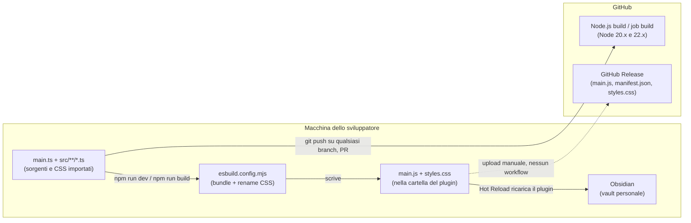

# CI/CD e rilascio

Come il codice diventa il `main.js` che Obsidian carica, cosa controlla GitHub Actions e come si pubblica una versione. Serve quando una build fallisce in CI, quando tocchi il CSS o quando devi rilasciare. La struttura del plugin sta in [01-architettura.md](./01-architettura.md).

## Il giro a colpo d'occhio

Il repo ha un solo workflow e nessun deploy automatico. La CI verifica che il codice compili, passi il lint e i test, poi butta via il risultato. Il plugin arriva nel vault perché il repo vive già dentro `.obsidian/plugins/obsidian-better-finder/`: la build scrive `main.js` e `styles.css` direttamente dove Obsidian li legge.



La freccia tratteggiata è l'unica strada documentata per distribuire il plugin, e la dice solo un commento. `.gitignore` righe 11-13

## I job

Il workflow si chiama "Node.js build" e ha un solo job, `build`, eseguito due volte dalla matrice:

| Job | Quando parte | Cosa fa | Cosa produce |
|---|---|---|---|
| `build` (Node 20.x) | push su qualsiasi branch, PR verso qualsiasi branch | `npm ci`, `npm run build --if-present`, `npm run lint`, `npm test` | niente: nessun `upload-artifact` |
| `build` (Node 22.x) | come sopra | come sopra | niente |

Il file è corto e si legge tutto:

```yaml
on:
    push:
        branches: ["**"]
    pull_request:
        branches: ["**"]

jobs:
    build:
        runs-on: ubuntu-latest

        strategy:
            matrix:
                node-version: [20.x, 22.x]
                # ...
            - run: npm ci
            - run: npm run build --if-present
            - run: npm run lint
            - run: npm test
```

`.github/workflows/lint.yml` righe 3-28

`npm run build` lancia prima `tsc -noEmit -skipLibCheck`, quindi un errore di tipo blocca la CI anche se esbuild, che non controlla i tipi, produrrebbe un bundle. `package.json` riga 10

**⚠️ Trappola**: `tsconfig.json` include `**/*.ts`, quindi il type-check copre anche i file morti del template (`src/main.ts`, `src/settings.ts`) e i test in `test/`. Un errore lì rompe la CI anche se quel codice non finisce nel bundle. `tsconfig.json` righe 21-23

ESLint non è in `devDependencies`: arriva come dipendenza transitiva fissata nel lockfile (8.57.1), quindi `npm ci` installa la versione 8 e vale `.eslintrc`, mentre `eslint.config.mts` importa pacchetti non installati e non viene caricato. `package-lock.json` righe 2740-2742

## La build

`esbuild.config.mjs` fa un bundle di `main.ts` in `main.js` (CommonJS, target es2018). Obsidian, Electron, CodeMirror e i moduli builtin di Node restano `external`: li fornisce l'app a runtime. In sviluppo resta in watch con sourcemap inline, mentre con l'argomento `production` minifica, costruisce una volta ed esce. `esbuild.config.mjs` righe 29-65

Ogni componente importa il suo `.css` dal `.ts` ed esbuild li unisce in `main.css`. Il plugin `renameCssPlugin` lo rinomina poi in `styles.css`, l'unico file di stile che Obsidian carica:

```js
const renameCssPlugin = {
	name: "rename-css",
	setup(build) {
		build.onEnd(async () => {
			try {
				await access("main.css");
				await rename("main.css", "styles.css");
			} catch {
				// ...
			}
		});
	},
};
```

`esbuild.config.mjs` righe 15-27

`styles.css` è un artefatto di build come `main.js`: nessuno dei due è in git, ed entrambi vanno allegati alla release. Prima era tracciato, e il watch di sviluppo lo riscriveva non minificato a ogni build, lasciandolo modificato in ogni working tree. `.gitignore` righe 11-19. Non modificarlo a mano: la build successiva lo sovrascrive.

Il `catch` vuoto ignora qualsiasi errore del rename, non solo il caso "nessun CSS". Se il rename fallisce (file bloccato su Windows, permessi), la build risulta riuscita e `styles.css` resta quello vecchio.

## Gli ambienti

C'è un solo ambiente, il vault di chi sviluppa, con il repo clonato in `.obsidian/plugins/`. `npm run dev` ricompila a ogni salvataggio e il plugin Hot Reload ricarica il risultato in Obsidian, attivandosi se nella cartella c'è `.git` o un file `.hotreload`. `README.md` righe 61-75

I log si vedono nella console degli strumenti per sviluppatori di Obsidian. Il repo non gestisce staging né produzione.

## Come si rilascia

Il rilascio è manuale e nessun tag di versione esiste ancora nel repo (`git tag` è vuoto): la versione in `package.json` e `manifest.json` è ancora `1.0.0`. La procedura è scritta nella skill `.claude/skills/release/SKILL.md`, pensata per un agente AI, che qui è riassunta come descrizione del processo. Obsidian scarica `main.js`, `manifest.json` e `styles.css` dalla release il cui tag è uguale a `version` di `manifest.json`, senza prefisso `v`. Passi:

1. Verifica in locale, dal branch `master` con working tree pulito: `npm run build`, `npm test` e `npm run lint` devono passare. La CI non lancia i test, quindi qui sei tu a farlo.
2. Alza la versione con `npm version <patch|minor|major|x.y.z>`. npm aggiorna `package.json`, poi esegue lo script `version`. `package.json` riga 11
3. Lo script `version` lancia `version-bump.mjs`, che copia la nuova versione in `manifest.json` e aggiunge a `versions.json` la coppia versione e `minAppVersion`. Poi fa `git add` dei due file, così entrano nel commit di versione. `version-bump.mjs` righe 3-14
4. Il tag è senza prefisso `v` (es. `1.0.1`) per `tag-version-prefix=""` in `.npmrc`. La skill usa `--no-git-tag-version` e crea commit e tag annotato a mano.
5. Lancia `npm run build` dal commit di versione: `main.js` non è in git, quindi l'asset va prodotto adesso.
6. Fai push del branch e del tag.
7. Crea la release su GitHub sul tag e allega `main.js`, `manifest.json` e `styles.css`. La skill la crea in bozza (`gh release create <versione> --draft`) e lascia a te la pubblicazione.

Per tornare indietro il repo non prevede niente: si ripubblica una release precedente o si installa a mano il `main.js` di un tag vecchio nella cartella del plugin.

**⚠️ Trappola**: il README descrive `npm run version` come il comando che alza la versione, ma non la alza. `README.md` riga 58. Lanciato direttamente, lo script legge `npm_package_version`, che è la versione già in `package.json`. Riscrive quindi `manifest.json` con lo stesso numero. La versione si alza solo con `npm version <tipo>`, che chiama lo script come hook. `version-bump.mjs` riga 3

## Cosa la pipeline non fa

- **Formattazione**: `npm run format:check` esiste ma la CI non lo chiama. `package.json` riga 9
- **Release**: nessun job crea tag, release o artefatti.
- **Metadati**: `manifest.json` ha ancora la descrizione del template e `package.json` il nome `obsidian-sample-plugin`. `manifest.json` riga 6

## Variabili e segreti

Il workflow non usa segreti né variabili di repository: non c'è niente da configurare su GitHub.
