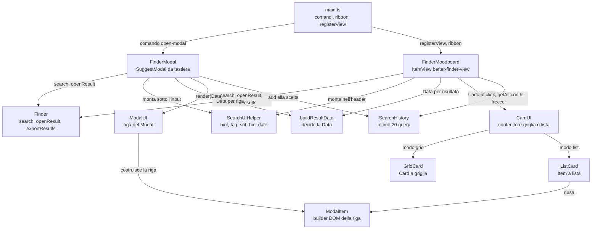

# Interfaccia: il Modal e la Moodboard

Il plugin ha due interfacce sopra lo stesso motore di ricerca: il **Modal**, un popup guidato da tastiera, e la **Moodboard**, una vista che si apre come tab del workspace con i risultati a griglia o a lista. Il percorso di una query fino al risultato è in [02-flusso-ricerca.md](./02-flusso-ricerca.md).

## Come è organizzata l'interfaccia

Il DOM è costruito a mano, senza framework UI. Il Modal è una `SuggestModal` e la Moodboard una `ItemView`, le classi base di Obsidian per un popup di suggerimenti e per un pannello del workspace: non serve un router.

| Cosa | Dove |
|---|---|
| Modal | `src/FinderModal.ts`, righe in `src/component/Modal/` |
| Moodboard | `src/FinderMoodboard.ts`, Card e righe in `src/component/Card/` |
| Hint bar condivisa | `src/SearchUIHelper.ts` |
| Componenti piccoli (titolo, tag, estratti, Preview) | `src/component/ui/` |
| Data di un risultato | `src/engine/ResultData.ts` |
| Stringhe UI in italiano | `i18n` in `src/const.ts` |

Il CSS sta accanto al componente e finisce in [styles.css](./05-ci-cd.md#la-build). Le regole del Modal sono limitate alla classe `better-finder-modal`, che aggiunge `onOpen`. `src/FinderModal.ts` righe 23-24

Le due viste condividono `Finder`, l'hint bar, `buildResultData` e `ModalItem`.



## Come si aprono

`main.ts` registra la vista e due [comandi](./04-sintassi-query.md#comandi-del-plugin): uno apre un Modal, l'altro la Moodboard, come l'icona nel ribbon se [`showRibbonIcon`](./04-sintassi-query.md#impostazioni) è attivo. `main.ts` righe 45-66

`activateFinderView` riusa la prima leaf (un pannello del workspace) che mostra già la vista, quindi la Moodboard è una sola per workspace. Ogni apertura del Modal crea invece un `FinderModal` e un `Finder` nuovi. `main.ts` righe 170-180

## Il Modal

`FinderModal` estende `SuggestModal`: Obsidian gestisce input, lista e tastiera, il plugin fornisce risultati, righe e azione alla scelta.

```
+---------------------------------------------+
| [ input della query                       ] |
| #  created:  modified:  >  title:  pdf ...  |  hint bar
| #spring  #java/jvm                          |  autocomplete tag
| today  yesterday ...  2026  YYYY/MM/DD      |  sub-hint date
+---------------------------------------------+
| Titolo [PDF]  data  cartella   | Preview    |
| Body (Preview o estratto)  #tag   2/5       |
+---------------------------------------------+
```

| Zona | Dove vive nel codice |
|---|---|
| Guscio, input e lista | `SuggestModal` di Obsidian; `getSuggestions` passa la query a `LatestSearch` e tiene l'esito, `src/FinderModal.ts` righe 48-52 |
| Hint bar, autocomplete tag, sub-hint date | `SearchUIHelper` inserito dopo `.prompt-input-container`, `src/FinderModal.ts` righe 23-40 |
| Riga di risultato | `renderResult` chiama `buildResultData` e `ModalUI.render`, `src/FinderModal.ts` righe 67-79; `src/component/Modal/ModalUI.ts` righe 19-55 |
| Colonna Preview | `ModalItem.setPreview` sposta il contenuto in un wrapper di testo e aggiunge la colonna a destra, `src/component/Modal/ModalItem.ts` righe 64-78 |
| Riga di comando (query con `>`) | `Finder.renderCommand`, nome, id e hotkey, `src/Finder.ts` righe 120-140 |
| Scelta | `onChooseSuggestion` salva la query in cronologia e apre il risultato, `src/FinderModal.ts` righe 62-65 |

Le righe si disegnano dall'esito della ricerca chiusa, non dall'input (vedi [LatestSearch](./02-flusso-ricerca.md#1-digiti-e-parte-solo-lultima-ricerca)). `src/FinderModal.ts` righe 14-15

Un click su una chip aggiunge l'etichetta alla query e rilancia un evento `input`, così `SuggestModal` ricalcola da sola. `src/FinderModal.ts` righe 81-97

## La Moodboard

`FinderMoodboard` è una `ItemView` con griglia o lista, scroll infinito, cronologia con le frecce, export e menu contestuale. Con `navigation = true`, aprendo un file nella stessa leaf il pulsante indietro di Obsidian riporta alla Moodboard. `src/FinderMoodboard.ts` righe 27-34

```
+------------------------------------------------+
| [ Search files... ]  12 risultati  [lista] [⤓] |  SearchBar
| #  created:  modified:  >  title:  ...         |  hint bar e sub-hint
+------------------------------------------------+
| +-----------+ +-----------+ +-----------+      |
| | Titolo    | | Titolo    | | Titolo    |      |  Card in griglia
| | Preview   | | Preview   | | Preview   |      |
| | data #tag | | data #tag | | data #tag |      |
| +-----------+ +-----------+ +-----------+      |
|            ... sentinella dello scroll ...     |
+------------------------------------------------+
```

| Zona | Dove vive nel codice |
|---|---|
| Header: input, contatore, toggle, export | `SearchBar`, `src/component/ui/SearchBar.ts` righe 11-67; montato da `buildUI`, `src/FinderMoodboard.ts` righe 59-82 |
| Toggle griglia o lista | `ToggleButton`, `src/component/ui/ToggleButton.ts`; lo ascolta `CardUI`, `src/component/Card/CardUI.ts` righe 21-25 |
| Card a griglia | `GridCard`, stili in linea, `src/component/Card/GridCard.ts` righe 20-49 |
| Item a lista | `ListCard`, riusa il `ModalItem` del Modal, `src/component/Card/ListCard.ts` righe 21-46 |
| Data di una Card | `buildResultData`, chiamata in `renderResult`, `src/FinderMoodboard.ts` righe 148-167 |
| Menu contestuale | evento nativo `file-menu`, lo stesso menu dell'esplora file, `src/FinderMoodboard.ts` righe 169-175 |

**⚠️ Trappola**: la Moodboard si apre vuota, perché `onOpen` costruisce la UI senza lanciare una ricerca. `src/FinderMoodboard.ts` righe 48-50

`FINDER_VIEW_TYPE` (`"better-finder-view"`) è salvato nei layout del workspace: non cambiarlo mai. `src/FinderMoodboard.ts` riga 11

### Scroll infinito

I risultati non hanno un tetto: la vista li tiene tutti e ne disegna 20 alla volta. In fondo all'ultimo blocco mette una sentinella osservata da un `IntersectionObserver` (l'API del browser che avvisa quando un elemento entra nell'area visibile), e quando si vede parte il blocco successivo. Ogni nuova ricerca stacca l'observer e riparte da zero. `src/FinderMoodboard.ts` righe 116-146

**⚠️ Trappola**: `attachSentinel` crea un `IntersectionObserver` a ogni blocco senza disconnettere il precedente. `this.observer` viene sovrascritto, quindi `destroyObserver`, alla ricerca successiva o alla chiusura, disconnette solo l'ultimo: i precedenti restano su una sentinella già rimossa dal DOM e non vengono mai liberati. `src/FinderMoodboard.ts` righe 177-185 e 201-206

### Export dei risultati

Il pulsante ⤓ esporta **tutti** i risultati, anche quelli che lo scroll non ha ancora disegnato: `Finder.exportResults` crea nella radice del vault una nota `Risultati ricerca <timestamp>.md` con query, conteggio e un wikilink per file, poi la apre. I comandi sono esclusi. `src/Finder.ts` righe 147-175

**⚠️ Trappola**: l'ora nel nome del file è in UTC. Il nome viene da `now.toISOString()`, mentre la riga della query dentro la nota usa `toLocaleString()`: a Roma in estate una ricerca delle 15:30 produce `Risultati ricerca 2026-07-14-13-30-00.md`. `src/Finder.ts` righe 161-165

### Differenze dal Modal

- Cronologia con le frecce, export e menu contestuale esistono solo qui.
- Il toggle griglia/lista non ridisegna: `CardUI` cambia classi CSS e `mode` per le Card future, quindi fino alla ricerca successiva convivono Card e Item. `src/component/Card/CardUI.ts` righe 21-25
- In [command mode](./04-sintassi-query.md#comandi-obsidian) i comandi compaiono ma non si lanciano: `renderResult` li disegna senza listener di click. `src/FinderMoodboard.ts` righe 148-166

## La Data di un risultato

La Data è quello che si decide di un risultato per mostrarlo: tag, quali la query ha chiesto, conteggio dei task, cosa va nel Body. Si calcola una volta per risultato dall'intera query, in `buildResultData`, ed è la stessa per Modal e Moodboard. Prima ogni vista aveva le sue regole, che divergevano su tag cercati, tag dei canvas e conteggio dei task. `src/engine/ResultData.ts` righe 9-44

```typescript
return {
  file,
  tags,
  searchedTags,
  taskInfo: parsed.taskFilter ? countTasks(app, file) : undefined,
  renderPreview: ImagePreview.hasPreview(app, file, { hasSnippet: !!(snippetTerm || taskSnippet) }),
  snippetTerm,
  taskSnippet,
};
```

`src/engine/ResultData.ts` righe 35-43

I renderer (`ModalUI`, `GridCard`, `ListCard`, `Tags`) disegnano solo ciò che trovano nella Data, senza rami per tipo di file:

- `tags` sono quelli del file come salvati; `searchedTags` quelli chiesti dalla query, annidati compresi (`#project` evidenzia `#project/alpha`).
- `taskInfo` c'è solo con un filtro [task:](./04-sintassi-query.md#task), in entrambe le viste.
- `snippetTerm` e `taskSnippet` valgono solo per le note `.md`.
- `buildResultData` non legge mai il contenuto dei file, solo i metadati e la [cache dei tag dei canvas](./03-flusso-indicizzazione.md#3-i-tag-dei-canvas-vanno-in-cache).

## Body, Preview e estratto

Il **Body** è la parte di una Card o di un Item sotto il titolo. La Data sceglie tra la **Preview** (cosa è il file), un estratto, le righe dei task o niente, e una nota con un estratto non ha Preview. `src/component/ui/ImagePreview.ts` righe 16-28

`ImagePreview.hasPreview` è l'unica risposta a "questo file ha una Preview?", accanto ai rami di `load`:

| Tipo di file | Preview | Dove |
|---|---|---|
| `.md` | primi 500 caratteri senza frontmatter, resi come markdown  | `src/component/ui/ImagePreview.ts` righe 40-47 |
| `.md` Excalidraw (`excalidraw-plugin: parsed`) | embed `![[...]]`  | `src/component/ui/ImagePreview.ts` righe 30-32 e 64 |
| png, jpg, jpeg, gif, webp, canvas, pdf | embed `![[...]]`  | `src/component/ui/ImagePreview.ts` righe 11 e 64 |
| `.json` | primi 300 caratteri come codice  | `src/component/ui/ImagePreview.ts` righe 49-56 |
| docx, xlsx | icona, estensione e fino a 200 caratteri estratti da [Xberg](./03-flusso-indicizzazione.md#4-xberg-estrae-il-testo-di-pdf-immagini-e-office)  | `src/component/ui/ImagePreview.ts` righe 75-88 |

`SnippetPreview` mostra 60 caratteri attorno alla prima occorrenza del testo libero, con il termine in `<mark>`. `TaskSnippet` mostra i primi 3 task nello stato richiesto e `+N` per gli altri. Con task e testo libero insieme, `ModalUI` mostra solo i task. `src/component/Modal/ModalUI.ts` righe 33-42; `src/component/ui/SnippetPreview.ts` righe 18-36; `src/component/ui/TaskSnippet.ts` righe 19-56

**⚠️ Trappola**: la Moodboard non disegna estratti, né in griglia né in lista. Una nota trovata per testo libero o con `task:` ha `renderPreview` falso (c'è un estratto) e `GridCard` e `ListCard` non lo disegnano, quindi il Body resta vuoto. Scelta temporanea fino all'issue #6; nel Modal l'estratto c'è. `src/engine/ResultData.ts` righe 31-40; `src/component/Card/GridCard.ts` righe 20-49

**⚠️ Trappola**: ogni Preview markdown fa girare i post-processor degli altri plugin, ed è la causa sospetta del freeze della Moodboard (nota in `.claude/skills/knowledge-memory/memories/2026-10-18-freeze-moodboard.md`). Il Modal passa a `ImagePreview` un `new Component()` mai caricato né scaricato. `src/component/ui/ImagePreview.ts` riga 44; `src/component/Modal/ModalUI.ts` riga 46

`CONTEXT.md` descrive cose che il codice non fa ancora: il pulsante Card/Preview e le Occurrences parola per parola. Oggi c'è un solo estratto, sul testo libero intero.

## Cronologia delle ricerche

`SearchHistory` tiene le ultime 20 query che hanno portato ad aprire un risultato. Una query ripetuta risale in cima e una vuota non entra. Il singleton non sa dove salvare, quindi `main.ts` gli passa all'avvio le voci di `data.json` e una callback che riscrive le [impostazioni](./04-sintassi-query.md#impostazioni). `src/engine/SearchHistory.ts` righe 21-34

```typescript
SearchHistory.getInstance().init(this.settings.searchHistory, (entries) => {
  this.settings.searchHistory = entries;
  this.saveSettings().catch(console.error);
});
```

`main.ts` righe 39-42

Entrambe le viste scrivono (il Modal in `onChooseSuggestion`, la Moodboard al click su una Card), ma solo la Moodboard legge. Qui le frecce scorrono la cronologia come in un terminale: `historyIndex` parte da -1, su va verso le query più vecchie, giù torna all'input vuoto. `src/FinderMoodboard.ts` righe 85-103

Il valore richiamato passa da `SearchBar.setValue`, che lancia un `input` sintetico; il listener usa `event.isTrusted` per azzerare `historyIndex` solo con la digitazione vera. `src/FinderMoodboard.ts` righe 73-80

Nel Modal la cronologia non si sfoglia: `FinderModal` non intercetta le frecce e `getAll` lo chiama solo la Moodboard. `src/FinderModal.ts` righe 23-40

## La barra degli hint

`SearchUIHelper` monta nello stesso contenitore tre pezzi, nell'ordine in cui compaiono:

1. `HintBar`: una chip per filtro, con la `label` come testo e la `desc` come tooltip, nell'ordine di registrazione dei filtri.
2. `TagsPreview`: mentre scrivi un [#tag](./04-sintassi-query.md#tag), mostra i primi 20 tag del vault che iniziano così, ordinati per frequenza.
3. `HintBarSub`: i valori di [created: e modified:](./04-sintassi-query.md#date) più l'anno corrente, visibili solo quando la query contiene uno dei due prefissi.

`src/SearchUIHelper.ts` righe 28-45

`HintBarSub` riceve i valori da `DATE_VALUES` di `DateFilter`, quindi aggiungere un valore data non tocca la UI; per un filtro nuovo vedi [Hint e sub-hint nella UI](./07-aggiungere-un-filtro.md#hint-e-sub-hint-nella-ui). Un click su un valore data passa da `toggleDateValue`, che sostituisce il valore corrente o lo toglie se è già quello. `src/SearchUIHelper.ts` righe 47-64

**⚠️ Trappola**: una chip si accende se la sua etichetta compare come sottostringa nella query, non se il filtro è stato riconosciuto. `-` si accende con `this-week`, `base` con `database`, `#` con qualsiasi tag. `src/Finder.ts` righe 66-72
